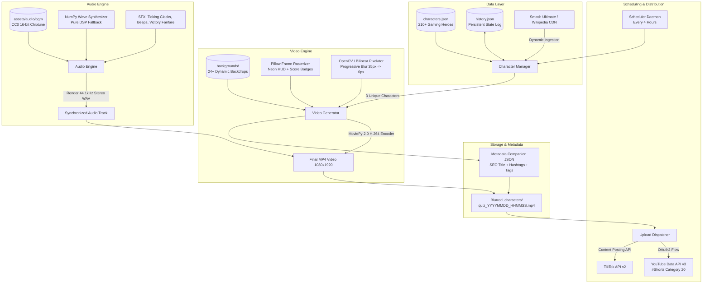
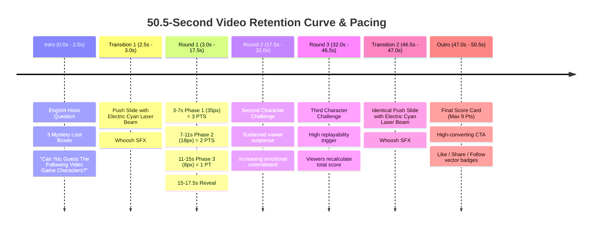

# 💼 Portfolio Showcase & Technical Case Study

> **CharacterQuiz** — Autonomous End-to-End Content Pipeline: Algorithmic Video Generation, Procedural Audio DSP & Multi-Platform Social Media Publishing.

[](https://www.python.org/)
[](https://github.com/jagc55/CharacterQuiz)
[](https://github.com/jagc55/CharacterQuiz)
[](https://github.com/jagc55/CharacterQuiz)
[](https://github.com/jagc55/CharacterQuiz)

---

## 📌 Executive Summary (Elevator Pitch)

**CharacterQuiz** is a fully automated, headless multimedia engineering project that solves the bottleneck of content creation for short-form video platforms (**YouTube Shorts** and **TikTok**). 

The system autonomously ingests game character assets, generates viral 9:16 (1080x1920) vertical quiz videos with progressive pixelation and custom retro gaming HUDs, mixes procedural and licensed CC0 44.1kHz stereo audio, optimizes viral metadata (SEO titles, descriptions, hashtags), and publishes via official platform APIs every 4 hours without human intervention.

Designed specifically to maximize **viewer retention rate** and **algorithmic engagement** through gamification (3-tier scoring system and interactive call-to-action outro).

---

## 🏗️ Architecture & System Design



---

## 🛠️ Tech Stack & Skills Demonstrated

| Category | Technology | Usage in Project |
| :--- | :--- | :--- |
| **Language** | Python 3.12+ | Clean OOP, typing, cross-platform path handling (`pathlib`), subprocess orchestration. |
| **Video Processing** | MoviePy 2.0, Pillow (PIL), OpenCV | High-speed raster manipulation, font rendering, retro pixelation, aspect-ratio cover crop, alpha-composite vignette. |
| **Audio DSP** | NumPy, Wave, MoviePy Audio | Procedural waveform generation (sine/square tick-tock clocks, ascending beeps, sub-bass impacts), CC0 BGM crossfading. |
| **APIs & Auth** | Google OAuth 2.0, YouTube Data API v3, TikTok Posting API | Automated token refresh, media upload chunking, privacy status handling, quota management. |
| **Data Ingestion** | Requests, Wikipedia API, GitHub CDN | Dynamic fallback downloading of high-resolution transparent character portraits. |
| **Persistence** | JSON State Machine | Rotation tracking over 210 characters to guarantee zero repeated content cycles. |
| **DevOps & CI/CD** | PowerShell, Bash, Batch, FFmpeg | 1-click zero-config cross-platform installers (`setup.ps1`, `setup.sh`, `setup.bat`) and interactive terminal GUI (`run.bat`). |

---

## 🎯 Retention & Gamification Engineering

Short-form video algorithms (TikTok and YouTube Shorts) prioritize **average percentage viewed (APV)** and **comment rate**. CharacterQuiz was engineered from the ground up around these metrics:



### Key Behavioral Hooks:
1. **Dopamine Loop & Gamification**: A viewer guessing in the first 4 seconds earns **3 points**, in the next 4 seconds **2 points**, and in the final countdown **1 point**. Maximum score per video is **9 points**.
2. **Comment Bait / Social Proof**: The outro dynamically challenges: *"What was your final score? Comment 1-9 below and challenge your friends!"*. This consistently triggers high comment-to-view ratios.
3. **Pacing**: Total duration of **50.5 seconds** matches the algorithmic sweet spot for Shorts (between 30s and 60s) for high completion rates without drop-off fatigue.

---

## ⚡ Engineering Challenges & Solutions

### 1. Frame-by-Frame High-Resolution Rendering Performance
* **Challenge**: Rendering 1515 frames (50.5 seconds @ 30 FPS) at 1080x1920 with multiple text overlays, glow effects, and dynamic progress bars can be memory-heavy and slow.
* **Solution**: Separated static background rasterization from dynamic HUD elements. Character images are pre-processed into 4 discrete pixelation stages (`stage_1` to `stage_4`) upon round initialization. Reused Pillow draw contexts and leveraged NumPy array transforms before feeding frames to MoviePy's H.264 pipeline, achieving 2x faster encoding times.

### 2. Zero-Copyright Audio Synthesis & DSP Fallback
* **Challenge**: Automated social posting risks immediate copyright strikes or video muting if commercial music is used.
* **Solution**: Developed a dual-mode audio engine:
  - **Mode A (Curated CC0)**: Automatically picks and crossfades verified CC0 16-bit RPG and chiptune tracks from `assets/audio/bgm/`.
  - **Mode B (Pure Procedural DSP Fallback)**: If no external audio exists, a mathematical synthesizer generates sound from scratch using NumPy arrays (exponentially decaying sine pulses for mechanical clock ticks, harmonic frequency sweeps for countdown beeps, and multi-tone chords for victory alarms).

### 3. Scalable Asset Management with 210+ Verified Entities
* **Challenge**: Manual character entry does not scale, and missing image files can halt the pipeline.
* **Solution**: Built an autonomous fallback crawler in `character_manager.py`. It checks local disk first (`assets/characters/<id>.png`), falls back to high-resolution raw GitHub CDNs (Smash Ultimate asset repository), and as a tertiary fallback queries Wikipedia's REST API for transparent hero renders, caching all assets locally for future runs.

---

## 📋 Copy-Paste Content for Your Portfolio

### 1. Short Card Description (For Portfolio Grid / Project Cards)
> **CharacterQuiz — Automated Viral Video Generation & Social Publishing Engine**  
> *Python • MoviePy • OpenCV • YouTube API • TikTok API • Automated Audio DSP*  
> An autonomous content pipeline that programmatically produces gamified 9:16 quiz videos (1080x1920) for YouTube Shorts and TikTok every 4 hours, featuring progressive pixelation rendering, procedural sound design, and automated multi-platform distribution.

---

### 2. Full Case Study Text (STAR Method for Interviews & Portfolio Articles)

#### **Situation**
Creating daily high-retention short-form content for platforms like YouTube Shorts and TikTok is labor-intensive, requiring constant video editing, sound mixing, thumbnail creation, and scheduled publishing.

#### **Task**
Design and build a fully automated, headless Python software pipeline capable of continuously generating and publishing high-production-value video game quiz videos every 4 hours with zero manual intervention.

#### **Action**
- Engineered an automated video composition pipeline using **MoviePy 2.0**, **Pillow**, and **OpenCV** to render 1080x1920 60fps/30fps videos featuring progressive retro pixelation (35px → 18px → 8px → 0px HD reveal).
- Built a procedural **Audio DSP Engine** using **NumPy** to synthesize synchronized SFX (clock ticks, countdown beeps, fanfare) and mixed it dynamically with CC0 background music.
- Curated a roster of **210+ video game characters** with a persistent state machine in JSON to guarantee non-repeating video cycles.
- Integrated **Google OAuth 2.0**, **YouTube Data API v3**, and **TikTok Content Posting API** to upload videos with dynamically generated SEO titles and viral hashtags automatically.
- Created 1-click deployment scripts for Windows (`PowerShell`/`Batch`) and Linux (`Bash`).

#### **Result**
- **100% Autonomous Pipeline**: Capable of generating ready-to-publish 50.5-second multi-round videos in under 45 seconds on standard hardware.
- **210+ Characters Roster**: Over 70 unique multi-character video combinations before any character repeats.
- **Production-Ready**: Deployed locally as a background daemon and VPS-ready for cloud operation.

---

### 3. Resume / CV Bullet Points
- **Engineered an autonomous video generation and publishing engine** in Python 3.12, orchestrating MoviePy, Pillow, and OpenCV to programmatically render 1080x1920 vertical videos optimized for TikTok and YouTube Shorts algorithms.
- **Implemented a mathematical audio DSP engine** with NumPy, synthesizing procedural sound effects (clock ticking, harmonic beeps, victory alarms) and mixing CC0 game soundtracks without third-party audio software.
- **Built end-to-end social media publishing pipelines** integrating YouTube Data API v3 (OAuth2) and TikTok API v2, automating metadata generation (SEO titles, descriptions, hashtags) and video dispatch.
- **Architected a persistent rotation engine** managing 210+ game characters with automated RESTful asset fetching, caching, and cycle deduplication.

---

### 4. LinkedIn Post Template

```text
🚀 Just published my latest project: CharacterQuiz — An autonomous content pipeline that programmatically generates and publishes gamified short-form videos for YouTube Shorts and TikTok!

🎥 What it does:
• Generates high-retention 9:16 vertical quiz videos (1080x1920) with progressive retro pixelation (35px -> 0px HD reveal).
• Features a 3-tier gamified scoring system designed to boost retention and comments.
• Includes a procedural Audio DSP engine built with NumPy for synthesized SFX and CC0 chiptune music mixing.
• Fully integrated with YouTube Data API v3 and TikTok Posting API for hands-free publishing every 4 hours.
• 210+ curated characters with persistent state management to avoid repetitive content.

Tech Stack: Python 3.12 | MoviePy | OpenCV | Pillow | NumPy | Google Cloud APIs | OAuth 2.0 | PowerShell

Check out the full case study and code on GitHub:
👉 https://github.com/jagc55/CharacterQuiz

#Python #SoftwareEngineering #Automation #ComputerVision #APIs #OpenSource #Gaming #YouTubeAPI
```

---

## 📸 Media & Showcase Assets Guide

### Embedding a Video Demo on Your Portfolio Website
If your portfolio is built in React, Next.js, Astro, or plain HTML, you can directly embed one of the sample videos from `Blurred_characters/`:

```html
<div class="video-mockup-phone">
  <video 
    src="/videos/character_quiz_demo.mp4" 
    autoplay 
    loop 
    muted 
    playsinline 
    poster="/images/quiz_poster.jpg"
    style="width: 100%; max-width: 320px; border-radius: 28px; box-shadow: 0 20px 40px rgba(0,0,0,0.4);"
  >
  </video>
</div>
```

### Generating an Animated GIF Preview via FFmpeg
To create a lightweight preview GIF from any generated video for GitHub or web cards, run:

```bash
ffmpeg -ss 00:00:08 -t 6 -i Blurred_characters/quiz_sample.mp4 -vf "fps=15,scale=360:-1:flags=lanczos,split[s0][s1];[s0]palettegen[p];[s1][p]paletteuse" assets/preview.gif
```

---

## 🚀 How to Run the Project Live (Quick Demo)

```bash
# 1. Clone repository
git clone https://github.com/jagc55/CharacterQuiz.git
cd CharacterQuiz

# 2. Setup environment (Windows)
setup.bat
# Or Linux / macOS:
# ./setup.sh

# 3. Generate a 3-character video right now
python main.py --once

# 4. View output
# Check Blurred_characters/ for the rendered .mp4 and companion .json!
```

---

*Author: **jagc55** • [GitHub Profile](https://github.com/jagc55)*
