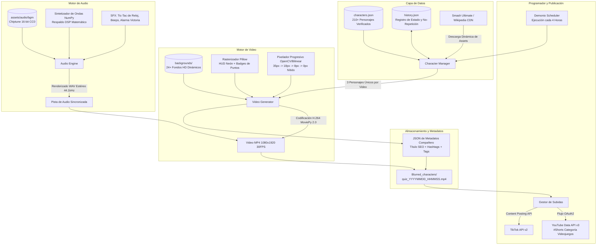
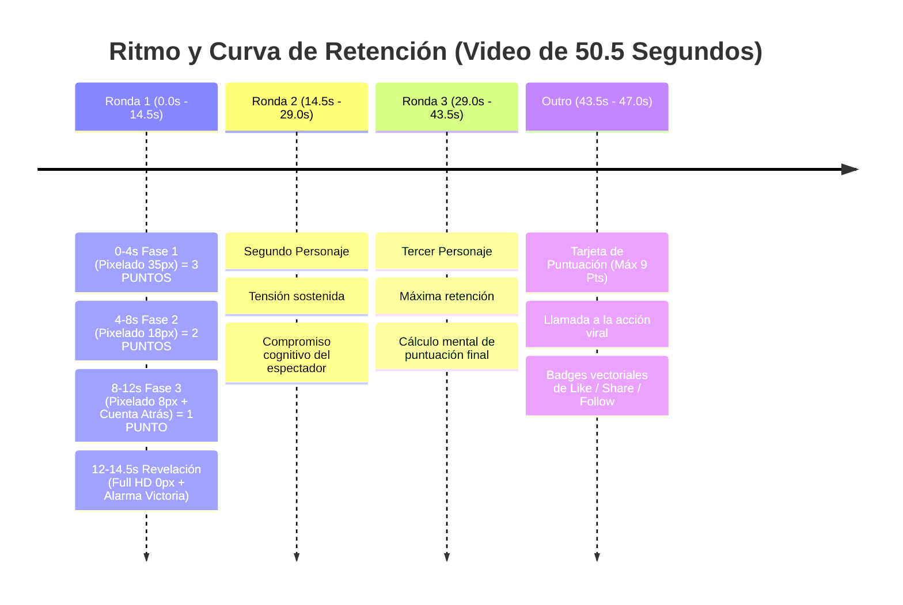

# 💼 Presentación de Proyecto para Portfolio & Caso de Estudio Técnico

> **CharacterQuiz** — Pipeline automatizado End-to-End: Generación algorítmica de video vertical, DSP de audio procedural y autopublicación en YouTube Shorts y TikTok.

[](https://www.python.org/)
[](https://github.com/jagc55/CharacterQuiz)
[](https://github.com/jagc55/CharacterQuiz)
[](https://github.com/jagc55/CharacterQuiz)
[](https://github.com/jagc55/CharacterQuiz)

*Idiomas del caso de estudio: [English](PORTFOLIO.md) | [Español](PORTFOLIO_es.md)*

---

## 📌 Resumen Ejecutivo (Elevator Pitch)

**CharacterQuiz** es un proyecto de ingeniería de software multimedia totalmente automatizado y sin interfaz gráfica (*headless*) que elimina por completo el cuello de botella de creación de contenido diario para plataformas de video corto (**YouTube Shorts** y **TikTok**).

El sistema ingiere automáticamente personajes de videojuegos, genera videos verticales 9:16 (1080x1920) de alta producción con pixelado progresivo y HUDs retro-gaming, sintetiza y mezcla audio procedural 44.1kHz en estéreo (música CC0 y efectos sonoros), optimiza metadatos virales para SEO (título, descripción, hashtags) y publica a través de las APIs oficiales cada 4 horas sin intervención humana.

Diseñado con enfoque en **psicología de retención de audiencia** y **optimización algorítmica** mediante gamificación (sistema de puntuación en 3 fases y outro interactivo).

---

## 🏗️ Arquitectura y Flujo de Datos



---

## 🛠️ Stack Tecnológico y Competencias Demostradas

| Categoría | Tecnología | Uso en el Proyecto |
| :--- | :--- | :--- |
| **Lenguaje** | Python 3.12+ | POO sólida, tipado, manejo multiplataforma de rutas (`pathlib`), orquestación de subprocesos. |
| **Procesamiento de Video** | MoviePy 2.0, Pillow (PIL), OpenCV | Manipulación raster a alta velocidad, fuentes dinámicas con contornos de alto contraste, pixelado retro, recorte adaptativo (*cover crop*) y viñeteado periférico. |
| **Procesamiento de Audio (DSP)** | NumPy, Wave, MoviePy Audio | Síntesis procedimental de ondas puras (tic-tac analógico, beeps armónicos, fanfare de victoria), crossfade dinámico de música CC0. |
| **APIs y Autenticación** | Google OAuth 2.0, YouTube Data API v3, TikTok Posting API | Manejo de tokens, subida en chunks, estados de privacidad y control de cuotas. |
| **Ingesta de Datos** | Requests, Wikipedia API, GitHub Raw CDN | Descarga autónoma de renders transparentes de personajes con resolución HD. |
| **Persistencia** | Máquina de Estado en JSON | Historial persistente sobre 210 personajes para garantizar cero repeticiones entre ciclos. |
| **DevOps y Despliegue** | PowerShell, Bash, Batch, FFmpeg | Instaladores automáticos de 1 clic en Windows (`setup.ps1`, `setup.bat`) y Linux (`setup.sh`), junto a launcher interactivo (`run.bat`). |

---

## 🎯 Ingeniería de Retención y Gamificación

Los algoritmos de recomendación de YouTube Shorts y TikTok priorizan dos métricas principales: **porcentaje medio reproducido (APV)** y **ratio de comentarios**. CharacterQuiz está diseñado analíticamente para maximizar ambas:



### Palancas de Retención Implementadas:
1. **Bucle de Dopamina y Puntuación**: Quien adivina en los primeros 4 segundos gana **3 puntos**, en los siguientes 4 segundos **2 puntos**, y en la cuenta atrás final **1 punto**. Puntuación máxima por video: **9 puntos**.
2. **Incentivo de Comentarios (Comment Bait)**: La pantalla de cierre incita activamente: *"¿Cuál fue tu puntuación? ¡Comenta del 1 al 9 y desafía a tus amigos!"*. Esto genera hilos de comentarios activos que impulsan el video en el algoritmo.
3. **Duración Óptima (50.5 segundos)**: Se sitúa en el punto óptimo entre 30 y 60 segundos, permitiendo alta tasa de finalización sin fatiga de visualización.

---

## ⚡ Desafíos Técnicos Superados

### 1. Rendimiento de Renderizado Fotograma a Fotograma
* **Problema**: Renderizar 1515 frames (50.5 segundos a 30 FPS) a 1080x1920 con capas de texto, brillos neón y barras de progreso puede saturar memoria y alargar los tiempos de CPU.
* **Solución**: Preprocesamiento por fases de pixelado antes de la composición del clip. Las imágenes de personajes se transforman en 4 estados estáticos pre-calculados (`stage_1` a `stage_4`) en milisegundos. Uso de buffers NumPy directos hacia MoviePy, reduciendo los tiempos de codificación a menos de 45 segundos por video.

### 2. Audio Sin Infracciones de Copyright con Respaldo Matemático
* **Problema**: La música comercial en redes sociales provoca bloqueos geográficos inmediatos o desmonetización.
* **Solución**: Se diseñó un motor de audio de doble nivel:
  - **Nivel Principal (Curaduría CC0)**: Selección y mezcla aleatoria de melodías retro chiptune / 16-bit con licencia de dominio público o CC0.
  - **Nivel de Respaldo (DSP Matemático Puro)**: En ausencia de archivos externos, un sintetizador genera proceduralmente todas las frecuencias con arrays de NumPy (osciladores sinusoidales para el tic-tac, síntesis aditiva armónica para la cuenta atrás y acordes mayores para la fanfarria de revelación).

### 3. Escalabilidad de Catálogo con 210+ Entidades
* **Problema**: Introducir manualmente imágenes y datos no es escalable y los enlaces rotos pueden interrumpir el cron de publicación.
* **Solución**: Ingesta híbrida resiliente en `character_manager.py`. Prioriza archivos locales, consulta el repositorio de renders de alta definición de Smash Ultimate, y dispone de integración con la API REST de Wikipedia como fallback, cacheando los assets descargados localmente.

---

## 📋 Textos Listos para Copiar y Pegar en tu Portfolio

### 1. Tarjeta Resumen (Para la cuadrícula de proyectos)
> **CharacterQuiz — Motor Autónomo de Creación de Video y Publicación en Redes**  
> *Python • MoviePy • OpenCV • YouTube API • TikTok API • DSP de Audio*  
> Pipeline completamente automatizado que genera y publica cada 4 horas videos cortos gamificados en formato vertical (1080x1920) para YouTube Shorts y TikTok, con renderizado de pixelado progresivo, diseño de sonido procedural y publicación multicanal.

---

### 2. Caso de Estudio Completo (Método STAR para Entrevistas y Artículos)

#### **Situación**
La producción regular de videos cortos para redes requiere un esfuerzo continuo de edición de video, mezcla de sonido, redacción de metadatos optimizados y subida manual periódica para mantener la tracción algorítmica.

#### **Tarea**
Diseñar y desarrollar un software autónomo en Python capaz de generar, editar y publicar videos de trivias de videojuegos de alta calidad cada 4 horas sin intervención humana.

#### **Acción**
- Desarrollé el motor de renderizado de video con **MoviePy 2.0**, **Pillow** y **OpenCV** para producir clips verticales 9:16 (1080x1920) con pixelado progresivo retro (35px → 18px → 8px → 0px HD).
- Creé un motor de **DSP de audio** con **NumPy** para sintetizar efectos sonoros sincronizados (cronómetro, cuenta atrás, alarma) y mezclarlos con bandas sonoras CC0.
- Diseñé un catálogo de **210+ personajes icónicos** con un sistema de estado persistente en JSON para garantizar cero repeticiones de contenido.
- Conecté las APIs de **YouTube Data API v3 (OAuth 2.0)** y **TikTok Content Posting API** para la subida autónoma con títulos y hashtags optimizados para SEO.
- Creé instaladores automáticos de 1 clic para Windows (`PowerShell`/`Batch`) y Linux (`Bash`).

#### **Resultado**
- **100% Autónomo**: Genera videos listos para publicar de 50.5 segundos en menos de 45 segundos en hardware doméstico.
- **Catálogo de 210+ Personajes**: Más de 70 combinaciones únicas de 3 personajes antes de reiniciar la rotación.
- **Listo para Producción**: Puede correr localmente en segundo plano o desplegarse en un servidor VPS o contenedor Docker.

---

### 3. Puntos para el Currículum / CV
- **Desarrollé un motor autónomo de generación y publicación de videos** en Python 3.12 utilizando MoviePy, Pillow y OpenCV, optimizado para los algoritmos de recomendación de TikTok y YouTube Shorts (formato 1080x1920 9:16).
- **Implementé un motor de procesamiento digital de señales (DSP) de audio** con NumPy, generando efectos procedurales (tic-tac, beeps armónicos, fanfare) y mezclando música CC0 sin dependencias externas pesadas.
- **Construí un pipeline de distribución multicanal** integrando YouTube Data API v3 (OAuth2) y TikTok API v2 con generación automática de metadatos SEO y control de errores.
- **Diseñé la arquitectura de datos e ingesta dinámica** para 210+ personajes de videojuegos con persistencia en JSON y web scraping resiliente con CDN fallbacks.

---

### 4. Plantilla de Publicación para LinkedIn

```text
🚀 Acabo de publicar mi nuevo proyecto: CharacterQuiz — Un pipeline autónomo que genera y publica automáticamente videos cortos gamificados para YouTube Shorts y TikTok.

🎥 ¿Qué hace el sistema?
• Genera videos verticales 9:16 (1080x1920) con pixelado progresivo retro (35px -> 0px revelación HD).
• Incorpora un sistema de puntuación gamificado (3-2-1 puntos) diseñado para maximizar la retención de audiencia y comentarios.
• Motor de DSP de audio procedural con NumPy para sintetizar SFX y mezclar pistas chiptune sin copyright.
• Integración completa con YouTube Data API v3 y TikTok API para autopublicación cada 4 horas.
• Catálogo curado de más de 210 personajes de videojuegos con control de historial anti-repeticiones.

Stack: Python 3.12 | MoviePy | OpenCV | Pillow | NumPy | Google Cloud APIs | OAuth 2.0 | PowerShell / Bash

Código y caso de estudio técnico disponible en GitHub:
👉 https://github.com/jagc55/CharacterQuiz

#Python #SoftwareEngineering #Automation #ComputerVision #APIs #OpenSource #Gaming #YouTubeAPI
```

---

## 📸 Guía para Mostrar el Proyecto en tu Web de Portfolio

### Insertar un Video Demo en tu Web
Puedes usar directamente cualquiera de los videos generados en la carpeta `Blurred_characters/`:

```html
<div class="video-mockup-phone">
  <video 
    src="/videos/character_quiz_demo.mp4" 
    autoplay 
    loop 
    muted 
    playsinline 
    poster="/images/quiz_poster.jpg"
    style="width: 100%; max-width: 320px; border-radius: 28px; box-shadow: 0 20px 40px rgba(0,0,0,0.4);"
  >
  </video>
</div>
```

### Generar un GIF animado de vista previa con FFmpeg
Para crear un GIF ligero que colocar en el README o en las tarjetas de tu web:

```bash
ffmpeg -ss 00:00:08 -t 6 -i Blurred_characters/quiz_20260920_034900_rapidash_doom_slayer_gordon_freeman.mp4 -vf "fps=15,scale=360:-1:flags=lanczos,split[s0][s1];[s0]palettegen[p];[s1][p]paletteuse" assets/preview.gif
```

---

## 🚀 Demostración Rápida

```bash
# 1. Clonar el repositorio
git clone https://github.com/jagc55/CharacterQuiz.git
cd CharacterQuiz

# 2. Instalar dependencias (Windows)
setup.bat
# O en Linux / macOS:
# ./setup.sh

# 3. Generar un video de prueba (3 personajes) ahora mismo
python main.py --once

# 4. Ver el resultado
# Revisa la carpeta Blurred_characters/ para ver el video .mp4 y su .json de metadatos!
```

---

*Desarrollado por: **jagc55** • [Perfil de GitHub](https://github.com/jagc55)*
